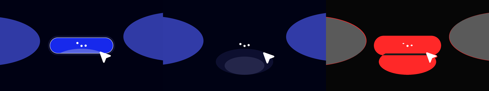
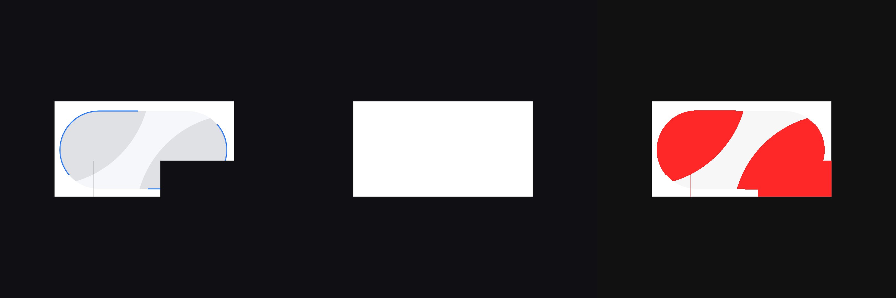
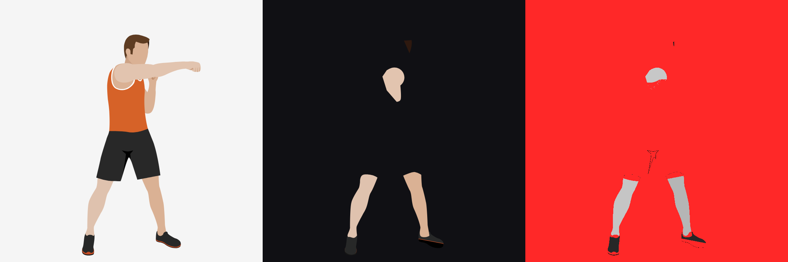
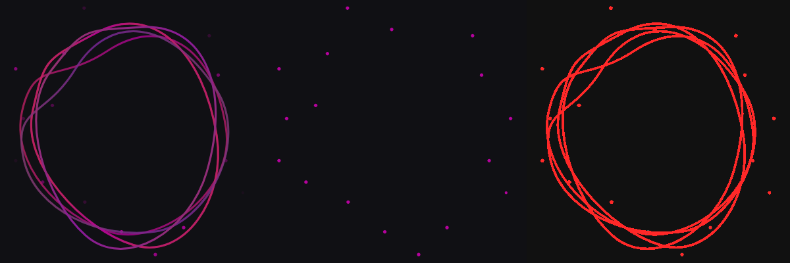
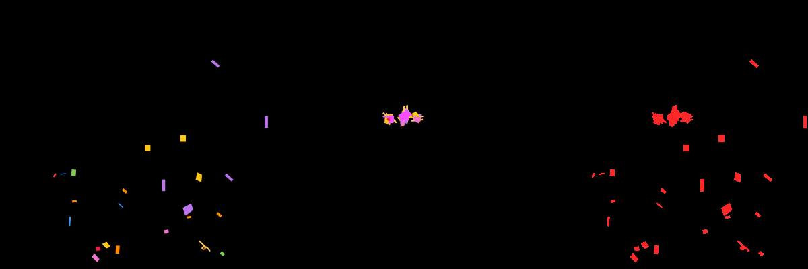

# MotionScript animation compatibility

> Historical evaluation `2026-10-07-baseline`, captured at 2026-10-07T14:29:58.967Z. Scene IR wire `0.1`, MotionScript wire `0.1`, packages `0.1.0`, no git commit. This report describes that revision only. It is not the current specification. The evaluation index is [../README.md](../README.md).

Evaluation of the import, MotionScript, compile, runtime, and canvas path as captured on 7 Oct 2026. Source files were not edited. After that capture, a new import replaces the canvas and a failed import clears it. An import with exact 0 and approximated 0 is not playable. The stage outcomes below are the capture. This file is the report. Machine-readable evidence is under `evidence/`.

## 1. Executive summary

Ten fixtures: eight Lottie JSON files, including the panning-landscape baseline, and two SMIL SVGs. Overall: **PASS 0, PARTIAL 6, FAIL 4, BLOCKED 0**. Reference playback: **PASS 9, FAIL 1, BLOCKED 0**.

Nothing in this pack is a native PASS. The baseline completes the pipeline and matches at the start, midpoint, and near the end, but the pan is offset at 25% and 75%. Six other Lottie files compile and draw a frame that drops the subject of the animation. Two Lottie files and both SVGs produce no accepted production scene.

| ID | File | Import | Emit | Compile | Runtime | Render | Reference | Overall |
| --- | --- | --- | --- | --- | --- | --- | --- | --- |
| LOT-00 | panning_landscape_motionscript_v1_compatible.json | DEGRADED | PASS | PASS | PASS | PARTIAL | PASS | PARTIAL |
| LOT-01 | Celebrations Begin.json | FAIL | NOT_REACHED | NOT_REACHED | NOT_REACHED | NOT_REACHED | PASS | FAIL |
| LOT-02 | Hover Button.json | PARTIAL | PASS | PASS | PASS | PARTIAL | PASS | PARTIAL |
| LOT-03 | lottie_ex1.json | FAIL | NOT_REACHED | NOT_REACHED | NOT_REACHED | NOT_REACHED | FAIL | FAIL |
| LOT-04 | lottie_ex2.json | PARTIAL | PASS | PASS | PASS | PARTIAL | PASS | PARTIAL |
| LOT-05 | lottie_simple_ex1.json | PARTIAL | PASS | PASS | PASS | PARTIAL | PASS | PARTIAL |
| LOT-06 | Punches.json | PARTIAL | PASS | PASS | PASS | PARTIAL | PASS | PARTIAL |
| LOT-07 | Wave Animation.json | PARTIAL | PASS | PASS | PASS | PARTIAL | PASS | PARTIAL |
| SVG-01 | Celebrations Begin.svg | FAIL | NOT_REACHED | NOT_REACHED | NOT_REACHED | NOT_REACHED | PASS | FAIL |
| SVG-02 | Jumping Jack.svg | FAIL | NOT_REACHED | NOT_REACHED | NOT_REACHED | NOT_REACHED | PASS | FAIL |

Render is `NOT_REACHED` when production `importSource` returned no scene. A diagnostic canvas is not a pass. Reference for LOT-03 is FAIL because lottie-web threw and the frames are empty, even though a PNG file was written.

## Visual quality gate

Manual scores, 7 Oct 2026. Picture and motion are each 0–4. The gate is the lower of the two. `—` means that side was not scored.

| ID | Picture | Motion | Gate | What was scored |
| --- | --- | --- | --- | --- |
| LOT-00 | 4 | 4 | 4 | Native playback. The manual gate treats the picture and the pan as a match. The harness still records a pixel difference at 25% and 75%. |
| LOT-01 | — | — | — | Not scored. Exact 0 and approximated 0, so this import is not playable. It produced no Scene IR. |
| LOT-02 | 1 | 2 | 1 | Native playback. |
| LOT-03 | — | — | — | Not scored. Exact 0 and approximated 0, so this import is not playable. It stopped on the size limit. |
| LOT-04 | — | — | — | Not scored. Play was greyed out. The import did produce a scene, and that scene has no tracks and no steps, so the player is disabled on purpose. |
| LOT-05 | 1 | 0 | 0 | Native playback. One visibility step is enough for the player to stay enabled. Nothing in the picture moves. |
| LOT-06 | 1 | 4 | 1 | Native playback. |
| LOT-07 | 1 | 0 | 0 | The still on the canvas was scored. Play was greyed out because this scene also has no tracks and no steps. |
| SVG-01 | — | — | — | Not scored. This import produced no Scene IR. Validation rejects 564 nodes. |
| SVG-02 | — | — | — | Not scored. This import produced no Scene IR. Validation rejects depth 20. |

Gate counts: 4 on one fixture (LOT-00), 1 on two (LOT-02, LOT-06), 0 on two (LOT-05, LOT-07), and five fixtures not scored.

### Why Play greys out

A scene with no tracks and no steps is static. The transport is turned off, and the session line says `static, player disabled`. LOT-04 and LOT-07 are in that state: the import succeeded, the canvas shows the new still, and Play stays grey because there is nothing to play. That is by design.

An import with exact 0 and approximated 0 is not playable. LOT-01 and LOT-03 are the fixtures in that state. SVG-01 and SVG-02 are also unplayable because validation dropped the scene, even though their exact counts are above 0.

A new import replaces the canvas. When the import produces no scene, the canvas clears and Play stays disabled. The caption says the import is not playable, or that it produced no Scene IR. The harness outcomes above were captured before this canvas change. Their PASS / PARTIAL / FAIL results are unchanged.

## 2. Environment

Captured 2026-10-07T14:29:58.967Z. /Users/daniel.yekini/Projects/generative-visual-runtime. Git: no commits on main. Node v24.10.0, npm 11.6.0, darwin arm64. Chrome Google Chrome 154.0.8037.98. Browser Mozilla/5.0 (Macintosh; Intel Mac OS X 10_15_7) AppleWebKit/537.36 (KHTML, like Gecko) HeadlessChrome/154.0.0.0 Safari/537.36.

Import core 0.1.0, Lottie adapter 0.1.0, SVG adapter 0.1.0, emitter 0.1.0, Scene IR 0.1, MotionScript 0.1. lottie-web 5.13.0, canvas renderer, `goToAndStop(frame, true)`, DPR 1. SVG reference uses `SVGSVGElement.setCurrentTime`.

Commands from the repository root:

```bash
npx tsx evaluation/harness/run-pipeline.ts
npx tsx evaluation/harness/continue-diagnostic.ts
npx tsx evaluation/harness/drive-browser.ts
```

The system report under each fixture is the production `formatImportReport` text, the same lines the studio prints (`STATUS`, `COUNTS`, then one diagnostic per line). `ROUND_TRIP` is the production emit/compile result. A failed import leaves no Scene IR, which is the studio message `Import produced no Scene IR.`

## 3. System reports

### LOT-00 panning_landscape_motionscript_v1_compatible.json

**PARTIAL.** Reference PASS. Manual gate 4 / 4. Full pipeline. The harness still shows a pixel difference at 25% and 75%.

Source `sources/LOT-00.json`. 1280×720, 30 fps, 8000 ms. SHA-256 `ae37d554cb66d8f1dd16540fca230b0ae21297f89c0e1125bdfaa57f39c53ee9`.

```
STATUS	degraded
COUNTS	exact	27	approximated	6	dropped	0	unsupported	0
IMPORT_APPROXIMATED	warning	approximated	layer_100	Bezier easing on layer_100.transform.position.x was mapped to Scene IR easing names.
IMPORT_APPROXIMATED	warning	approximated	layer_100	Bezier easing on layer_100.transform.position.y was mapped to Scene IR easing names.
IMPORT_EXACT	info	exact	layer_100.layer_1.Tree1CanopyEllipse	Imported ellipse layer_100.layer_1.Tree1CanopyEllipse.
IMPORT_EXACT	info	exact	layer_100.layer_2.Tree1TrunkRect	Imported rectangle layer_100.layer_2.Tree1TrunkRect.
IMPORT_EXACT	info	exact	layer_100.layer_3.Tree2CanopyEllipse	Imported ellipse layer_100.layer_3.Tree2CanopyEllipse.
IMPORT_EXACT	info	exact	layer_100.layer_4.Tree2TrunkRect	Imported rectangle layer_100.layer_4.Tree2TrunkRect.
IMPORT_EXACT	info	exact	layer_100.layer_5.Tree3CanopyEllipse	Imported ellipse layer_100.layer_5.Tree3CanopyEllipse.
IMPORT_EXACT	info	exact	layer_100.layer_6.Tree3TrunkRect	Imported rectangle layer_100.layer_6.Tree3TrunkRect.
IMPORT_EXACT	info	exact	layer_100.layer_7.Tree4CanopyEllipse	Imported ellipse layer_100.layer_7.Tree4CanopyEllipse.
IMPORT_EXACT	info	exact	layer_100.layer_8.Tree4TrunkRect	Imported rectangle layer_100.layer_8.Tree4TrunkRect.
IMPORT_EXACT	info	exact	layer_100.layer_9.Tree5CanopyEllipse	Imported ellipse layer_100.layer_9.Tree5CanopyEllipse.
IMPORT_EXACT	info	exact	layer_100.layer_10.Tree5TrunkRect	Imported rectangle layer_100.layer_10.Tree5TrunkRect.
IMPORT_EXACT	info	exact	layer_100.layer_11.Tree6CanopyEllipse	Imported ellipse layer_100.layer_11.Tree6CanopyEllipse.
IMPORT_EXACT	info	exact	layer_100.layer_12.Tree6TrunkRect	Imported rectangle layer_100.layer_12.Tree6TrunkRect.
IMPORT_EXACT	info	exact	layer_100.layer_13.ForegroundGroundRect	Imported rectangle layer_100.layer_13.ForegroundGroundRect.
IMPORT_APPROXIMATED	warning	approximated	layer_200	Bezier easing on layer_200.transform.position.x was mapped to Scene IR easing names.
IMPORT_APPROXIMATED	warning	approximated	layer_200	Bezier easing on layer_200.transform.position.y was mapped to Scene IR easing names.
IMPORT_EXACT	info	exact	layer_200.layer_14.MidHill1Ellipse	Imported ellipse layer_200.layer_14.MidHill1Ellipse.
IMPORT_EXACT	info	exact	layer_200.layer_15.MidHill2Ellipse	Imported ellipse layer_200.layer_15.MidHill2Ellipse.
IMPORT_EXACT	info	exact	layer_200.layer_16.MidHill3Ellipse	Imported ellipse layer_200.layer_16.MidHill3Ellipse.
IMPORT_APPROXIMATED	warning	approximated	layer_300	Bezier easing on layer_300.transform.position.x was mapped to Scene IR easing names.
IMPORT_APPROXIMATED	warning	approximated	layer_300	Bezier easing on layer_300.transform.position.y was mapped to Scene IR easing names.
IMPORT_EXACT	info	exact	layer_300.layer_17.Cloud1Ellipse	Imported ellipse layer_300.layer_17.Cloud1Ellipse.
IMPORT_EXACT	info	exact	layer_300.layer_18.Cloud2Ellipse	Imported ellipse layer_300.layer_18.Cloud2Ellipse.
IMPORT_EXACT	info	exact	layer_300.layer_19.Cloud3Ellipse	Imported ellipse layer_300.layer_19.Cloud3Ellipse.
IMPORT_EXACT	info	exact	layer_300.layer_20.Cloud4Ellipse	Imported ellipse layer_300.layer_20.Cloud4Ellipse.
IMPORT_EXACT	info	exact	layer_300.layer_21.Mountain1Path	Imported path layer_300.layer_21.Mountain1Path.
IMPORT_EXACT	info	exact	layer_300.layer_22.Mountain2Path	Imported path layer_300.layer_22.Mountain2Path.
IMPORT_EXACT	info	exact	layer_300.layer_23.Mountain3Path	Imported path layer_300.layer_23.Mountain3Path.
IMPORT_EXACT	info	exact	layer_300.layer_24.Mountain4Path	Imported path layer_300.layer_24.Mountain4Path.
IMPORT_EXACT	info	exact	layer_300.layer_25.SunEllipse	Imported ellipse layer_300.layer_25.SunEllipse.
IMPORT_EXACT	info	exact	layer_26.SkyRect	Imported rectangle layer_26.SkyRect.
IMPORT_EXACT	info	exact		Converted composition frames 0–240 at 30fps to 8000ms.
```

```
ROUND_TRIP
Emitted MotionScript compiled with 0 diagnostics.
```

Pixel check (inspection aid, not the pass rule): start: fraction 0.0001, mean 1.09; q25: fraction 0.1315, mean 15.23; q50: fraction 0.0001, mean 1.07; q75: fraction 0.1444, mean 18.52; near_end: fraction 0.0101, mean 2.03.


### LOT-01 Celebrations Begin.json

**FAIL.** Reference PASS. Manual gate not scored. Exact 0 and approximated 0, so this import is not playable. It returns no Scene IR. A new import clears the canvas.

Source `sources/LOT-01.json`. 400×400, 30 fps, 4033 ms. SHA-256 `e226bf89fb6daeb72a7f2d9574fdc036c247c59d452957c75e009cb10b96017d`.

```
STATUS	failed
COUNTS	exact	0	approximated	0	dropped	0	unsupported	2
IMPORT_UNSUPPORTED	fatal	unsupported	layer_1	Layer type 0 is outside the v0.1 subset.
IMPORT_UNSUPPORTED	fatal	unsupported		No supported layers were found.
```

```
ROUND_TRIP
Import produced no Scene IR.
```


### LOT-02 Hover Button.json

**PARTIAL.** Reference PASS. Manual gate 1 (picture 1, motion 2). Pipeline plays a remnant. Button, text, gradient, and trim are missing.

Source `sources/LOT-02.json`. 1920×1080, 30 fps, 7533 ms. SHA-256 `e65bb5bb0e7fc2f7dee4483e62ba469b59fbb75e3638eec2ae4ed37bf0c44c7e`.

```
STATUS	partial
COUNTS	exact	20	approximated	16	dropped	0	unsupported	18
IMPORT_UNSUPPORTED	error	unsupported	layer_1	Layer type 5 is outside the v0.1 subset.
IMPORT_UNSUPPORTED	error	unsupported	layer_8	Layer type 0 is outside the v0.1 subset.
IMPORT_APPROXIMATED	warning	approximated	layer_3	Bezier easing on layer_3.transform.scale.x was mapped to Scene IR easing names.
IMPORT_APPROXIMATED	warning	approximated	layer_3	Bezier easing on layer_3.transform.scale.y was mapped to Scene IR easing names.
IMPORT_EXACT	info	exact	layer_3.Ellipse1.EllipsePath1	Imported ellipse layer_3.Ellipse1.EllipsePath1.
IMPORT_EXACT	info	exact	layer_3.layer_2.Shape1.Path1	Imported path layer_3.layer_2.Shape1.Path1.
IMPORT_UNSUPPORTED	error	unsupported	layer_3.layer_2	Shape item tm is outside the v0.1 subset.
IMPORT_APPROXIMATED	warning	approximated	layer_4	Bezier easing on layer_4.transform.position.x was mapped to Scene IR easing names.
IMPORT_APPROXIMATED	warning	approximated	layer_4	Bezier easing on layer_4.transform.position.y was mapped to Scene IR easing names.
IMPORT_APPROXIMATED	warning	approximated	layer_4	Bezier easing on layer_4.transform.scale.x was mapped to Scene IR easing names.
IMPORT_APPROXIMATED	warning	approximated	layer_4	Bezier easing on layer_4.transform.scale.y was mapped to Scene IR easing names.
IMPORT_EXACT	info	exact	layer_4.Group1.Path1	Imported path layer_4.Group1.Path1.
IMPORT_APPROXIMATED	warning	approximated	layer_5	Bezier easing on layer_5.transform.position.x was mapped to Scene IR easing names.
IMPORT_APPROXIMATED	warning	approximated	layer_5	Bezier easing on layer_5.transform.position.y was mapped to Scene IR easing names.
IMPORT_EXACT	info	exact	layer_5.Ellipse1.EllipsePath1	Imported ellipse layer_5.Ellipse1.EllipsePath1.
IMPORT_APPROXIMATED	warning	approximated	layer_6	Bezier easing on layer_6.transform.position.x was mapped to Scene IR easing names.
IMPORT_APPROXIMATED	warning	approximated	layer_6	Bezier easing on layer_6.transform.position.y was mapped to Scene IR easing names.
IMPORT_EXACT	info	exact	layer_6.Ellipse1.EllipsePath1	Imported ellipse layer_6.Ellipse1.EllipsePath1.
IMPORT_APPROXIMATED	warning	approximated	layer_7	Bezier easing on layer_7.transform.position.x was mapped to Scene IR easing names.
IMPORT_APPROXIMATED	warning	approximated	layer_7	Bezier easing on layer_7.transform.position.y was mapped to Scene IR easing names.
IMPORT_EXACT	info	exact	layer_7.Ellipse1.EllipsePath1	Imported ellipse layer_7.Ellipse1.EllipsePath1.
IMPORT_APPROXIMATED	warning	approximated	layer_18	Bezier easing on layer_18.transform.scale.x was mapped to Scene IR easing names.
IMPORT_APPROXIMATED	warning	approximated	layer_18	Bezier easing on layer_18.transform.scale.y was mapped to Scene IR easing names.
IMPORT_UNSUPPORTED	error	unsupported	layer_18.Rectangle1	Rounded rectangle corners are outside the v0.1 subset.
IMPORT_UNSUPPORTED	error	unsupported	layer_18.layer_9.Rectangle1	Rounded rectangle corners are outside the v0.1 subset.
IMPORT_UNSUPPORTED	error	unsupported	layer_18.layer_9	Shape item tm is outside the v0.1 subset.
IMPORT_UNSUPPORTED	error	unsupported	layer_18.layer_10.Rectangle1	Rounded rectangle corners are outside the v0.1 subset.
IMPORT_UNSUPPORTED	error	unsupported	layer_18.layer_10	Shape item tm is outside the v0.1 subset.
IMPORT_EXACT	info	exact	layer_18.layer_11	Imported motion on layer_18.layer_11.transform.position.x.
IMPORT_EXACT	info	exact	layer_18.layer_11	Imported motion on layer_18.layer_11.transform.position.y.
IMPORT_UNSUPPORTED	error	unsupported	layer_18.layer_11.Rectangle1	Rounded rectangle corners are outside the v0.1 subset.
IMPORT_UNSUPPORTED	error	unsupported	layer_18.layer_11.Rectangle1	Shape item gf is outside the v0.1 subset.
IMPORT_UNSUPPORTED	error	unsupported	layer_18.layer_12.Rectangle1	Rounded rectangle corners are outside the v0.1 subset.
IMPORT_UNSUPPORTED	error	unsupported	layer_18.layer_12	Shape item tm is outside the v0.1 subset.
IMPORT_EXACT	info	exact	layer_18.layer_13	Imported motion on layer_18.layer_13.transform.position.x.
IMPORT_EXACT	info	exact	layer_18.layer_13	Imported motion on layer_18.layer_13.transform.position.y.
IMPORT_UNSUPPORTED	error	unsupported	layer_18.layer_13.Rectangle1	Rounded rectangle corners are outside the v0.1 subset.
IMPORT_UNSUPPORTED	error	unsupported	layer_18.layer_13.Rectangle1	Shape item gf is outside the v0.1 subset.
IMPORT_UNSUPPORTED	error	unsupported	layer_18.layer_14.Rectangle1	Rounded rectangle corners are outside the v0.1 subset.
IMPORT_APPROXIMATED	warning	approximated	layer_18.layer_15	Bezier easing on layer_18.layer_15.transform.position.x was mapped to Scene IR easing names.
IMPORT_APPROXIMATED	warning	approximated	layer_18.layer_15	Bezier easing on layer_18.layer_15.transform.position.y was mapped to Scene IR easing names.
IMPORT_EXACT	info	exact	layer_18.layer_15.Ellipse2.EllipsePath1	Imported ellipse layer_18.layer_15.Ellipse2.EllipsePath1.
IMPORT_EXACT	info	exact	layer_18.layer_15.Ellipse1.EllipsePath1	Imported ellipse layer_18.layer_15.Ellipse1.EllipsePath1.
IMPORT_UNSUPPORTED	error	unsupported	layer_18.layer_16.Rectangle1	Rounded rectangle corners are outside the v0.1 subset.
IMPORT_UNSUPPORTED	error	unsupported	layer_18.layer_17.Rectangle1	Rounded rectangle corners are outside the v0.1 subset.
IMPORT_UNSUPPORTED	error	unsupported	layer_18.layer_17.Rectangle1	Shape item gs is outside the v0.1 subset.
IMPORT_EXACT	info	exact	layer_19	Imported motion on layer_19.transform.position.x.
IMPORT_EXACT	info	exact	layer_19	Imported motion on layer_19.transform.position.y.
IMPORT_EXACT	info	exact	layer_19.Ellipse2.EllipsePath1	Imported ellipse layer_19.Ellipse2.EllipsePath1.
IMPORT_EXACT	info	exact	layer_20	Imported motion on layer_20.transform.position.x.
IMPORT_EXACT	info	exact	layer_20	Imported motion on layer_20.transform.position.y.
IMPORT_EXACT	info	exact	layer_20.Ellipse1.EllipsePath1	Imported ellipse layer_20.Ellipse1.EllipsePath1.
IMPORT_EXACT	info	exact	layer_21.Rectangle1.RectanglePath1	Imported rectangle layer_21.Rectangle1.RectanglePath1.
IMPORT_EXACT	info	exact		Converted composition frames 0–226 at 30fps to 7533.333333333333ms.
```

```
ROUND_TRIP
Emitted MotionScript compiled with 0 diagnostics.
```

Pixel check (inspection aid, not the pass rule): start: fraction 0.0919, mean 15.31; q25: fraction 0.3715, mean 63.23; q50: fraction 0.1422, mean 21.14; q75: fraction 0.2638, mean 44.39; near_end: fraction 0.1308, mean 18.06.



### LOT-03 lottie_ex1.json

**FAIL.** Reference FAIL. Manual gate not scored. Exact 0 and approximated 0, so this import is not playable. Production import stops on the 512 KiB limit. Reference canvas stayed empty after a player exception. A new import clears the canvas.

Source `sources/LOT-03.json`. 1080×689, 60 fps, 7117 ms. SHA-256 `71ace8816997393496592feda711a6998fcaa8576f42d2fe260267772e988551`.

```
STATUS	failed
COUNTS	exact	0	approximated	0	dropped	0	unsupported	1
IMPORT_LIMIT	fatal	unsupported	1:1	Source exceeds the import size limit.
```

```
ROUND_TRIP
Import produced no Scene IR.
```

Diagnostic continuation, not the production route: validation ok, emit 2157 chars, compile true. 

Pixel check (inspection aid, not the pass rule): start: fraction 1.0000, mean 411.66; q25: fraction 1.0000, mean 411.66; q50: fraction 1.0000, mean 411.66; q75: fraction 1.0000, mean 411.66; near_end: fraction 1.0000, mean 411.66.


### LOT-04 lottie_ex2.json

**PARTIAL.** Reference PASS. Manual gate not scored. Play is greyed out because the imported scene has no tracks and no steps. The still is the two static paths. The moving type is inside a precomp and is absent.

Source `sources/LOT-04.json`. 500×888.89, 60 fps, 11250 ms. SHA-256 `85bf9bedf34366f165be86acf9ca7a076ebb0c42581472e4b0723eca62333601`.

```
STATUS	partial
COUNTS	exact	3	approximated	0	dropped	0	unsupported	2
IMPORT_UNSUPPORTED	error	unsupported	layer_1	Layer type 0 is outside the v0.1 subset.
IMPORT_EXACT	info	exact	layer_2.Group1.Group1.Path2	Imported path layer_2.Group1.Group1.Path2.
IMPORT_UNSUPPORTED	error	unsupported	layer_2.Group1	Shape item gf is outside the v0.1 subset.
IMPORT_EXACT	info	exact	layer_3.Group1.Path1	Imported path layer_3.Group1.Path1.
IMPORT_EXACT	info	exact		Converted composition frames 0–675 at 60fps to 11250ms.
```

```
ROUND_TRIP
Emitted MotionScript compiled with 0 diagnostics.
```

Pixel check (inspection aid, not the pass rule): start: fraction 0.0844, mean 8.33; q25: fraction 0.0800, mean 8.86; q50: fraction 0.0794, mean 8.14; q75: fraction 0.0820, mean 8.08; near_end: fraction 0.0844, mean 8.33.


### LOT-05 lottie_simple_ex1.json

**PARTIAL.** Reference PASS. Manual gate 0 (picture 1, motion 0). Pipeline shows one white rectangle. The play-button artwork is a precomp. A visibility step keeps the player enabled.

Source `sources/LOT-05.json`. 1080×1080, 60 fps, 4017 ms. SHA-256 `2891a929c3c3f0402e8fd2c749c498152fc7d5daba6454bd11888b650a4757d2`.

```
STATUS	partial
COUNTS	exact	2	approximated	0	dropped	0	unsupported	1
IMPORT_UNSUPPORTED	error	unsupported	layer_1	Layer type 0 is outside the v0.1 subset.
IMPORT_EXACT	info	exact	layer_2.RectShape1	Imported rectangle layer_2.RectShape1.
IMPORT_EXACT	info	exact		Converted composition frames 0–241 at 60fps to 4016.6666666666665ms.
```

```
ROUND_TRIP
Emitted MotionScript compiled with 0 diagnostics.
```

Pixel check (inspection aid, not the pass rule): start: fraction 0.0918, mean 5.83; q25: fraction 0.1039, mean 17.03; q50: fraction 0.1039, mean 17.03; q75: fraction 0.1039, mean 17.03; near_end: fraction 0.1039, mean 17.03.



### LOT-06 Punches.json

**PARTIAL.** Reference PASS. Manual gate 1 (picture 1, motion 4). Pipeline plays a broken figure. Animated paths and the hex solid background are lost.

Source `sources/LOT-06.json`. 720×720, 25 fps, 960 ms. SHA-256 `111f7aff92691d80a9e344dabd823ea2441f9245d23c5de02ee867c979fa29c1`.

```
STATUS	partial
COUNTS	exact	14	approximated	39	dropped	0	unsupported	24
IMPORT_APPROXIMATED	warning	approximated	layer_4	Bezier easing on layer_4.transform.position.x was mapped to Scene IR easing names.
IMPORT_APPROXIMATED	warning	approximated	layer_4	Bezier easing on layer_4.transform.position.y was mapped to Scene IR easing names.
IMPORT_APPROXIMATED	warning	approximated	layer_4	Bezier easing on layer_4.transform.rotation was mapped to Scene IR easing names.
IMPORT_UNSUPPORTED	error	unsupported	layer_4.Group1	Animated path geometry is outside the v0.1 subset.
IMPORT_APPROXIMATED	warning	approximated	layer_4.layer_3	Bezier easing on layer_4.layer_3.transform.position.x was mapped to Scene IR easing names.
IMPORT_APPROXIMATED	warning	approximated	layer_4.layer_3	Bezier easing on layer_4.layer_3.transform.position.y was mapped to Scene IR easing names.
IMPORT_APPROXIMATED	warning	approximated	layer_4.layer_3	Bezier easing on layer_4.layer_3.transform.rotation was mapped to Scene IR easing names.
IMPORT_UNSUPPORTED	error	unsupported	layer_4.layer_3.Group1	Animated path geometry is outside the v0.1 subset.
IMPORT_APPROXIMATED	warning	approximated	layer_4.layer_3.layer_2	Bezier easing on layer_4.layer_3.layer_2.transform.position.x was mapped to Scene IR easing names.
IMPORT_APPROXIMATED	warning	approximated	layer_4.layer_3.layer_2	Bezier easing on layer_4.layer_3.layer_2.transform.position.y was mapped to Scene IR easing names.
IMPORT_APPROXIMATED	warning	approximated	layer_4.layer_3.layer_2	Bezier easing on layer_4.layer_3.layer_2.transform.rotation was mapped to Scene IR easing names.
IMPORT_UNSUPPORTED	error	unsupported	layer_4.layer_3.layer_2.Group1	Animated path geometry is outside the v0.1 subset.
IMPORT_APPROXIMATED	warning	approximated	layer_4.layer_3.layer_2.layer_1	Bezier easing on layer_4.layer_3.layer_2.layer_1.transform.position.x was mapped to Scene IR easing names.
IMPORT_APPROXIMATED	warning	approximated	layer_4.layer_3.layer_2.layer_1	Bezier easing on layer_4.layer_3.layer_2.layer_1.transform.position.y was mapped to Scene IR easing names.
IMPORT_APPROXIMATED	warning	approximated	layer_4.layer_3.layer_2.layer_1	Bezier easing on layer_4.layer_3.layer_2.layer_1.transform.rotation was mapped to Scene IR easing names.
IMPORT_UNSUPPORTED	error	unsupported	layer_4.layer_3.layer_2.layer_1.Group1.Group4	Animated path geometry is outside the v0.1 subset.
IMPORT_UNSUPPORTED	error	unsupported	layer_4.layer_3.layer_2.layer_1.Group1.Group1	Animated path geometry is outside the v0.1 subset.
IMPORT_UNSUPPORTED	error	unsupported	layer_4.layer_3.layer_2.layer_1.Group1.Group2	Animated path geometry is outside the v0.1 subset.
IMPORT_UNSUPPORTED	error	unsupported	layer_4.layer_3.layer_2.layer_1.Group1.Group3	Animated path geometry is outside the v0.1 subset.
IMPORT_UNSUPPORTED	error	unsupported	layer_4.layer_3.layer_2.layer_1.Group2	Animated path geometry is outside the v0.1 subset.
IMPORT_APPROXIMATED	warning	approximated	layer_5	Bezier easing on layer_5.transform.position.x was mapped to Scene IR easing names.
IMPORT_APPROXIMATED	warning	approximated	layer_5	Bezier easing on layer_5.transform.position.y was mapped to Scene IR easing names.
IMPORT_UNSUPPORTED	error	unsupported	layer_5.Group1.Group1.Group1	Animated path geometry is outside the v0.1 subset.
IMPORT_UNSUPPORTED	error	unsupported	layer_5.Group1.Group1.Group2	Animated path geometry is outside the v0.1 subset.
IMPORT_APPROXIMATED	warning	approximated	layer_17	Bezier easing on layer_17.transform.position.x was mapped to Scene IR easing names.
IMPORT_APPROXIMATED	warning	approximated	layer_17	Bezier easing on layer_17.transform.position.y was mapped to Scene IR easing names.
IMPORT_APPROXIMATED	warning	approximated	layer_17	Bezier easing on layer_17.transform.rotation was mapped to Scene IR easing names.
IMPORT_UNSUPPORTED	error	unsupported	layer_17.Group1	Animated path geometry is outside the v0.1 subset.
IMPORT_EXACT	info	exact	layer_17.layer_18.Group1.Path1	Imported path layer_17.layer_18.Group1.Path1.
IMPORT_APPROXIMATED	warning	approximated	layer_17.layer_18.layer_19	Bezier easing on layer_17.layer_18.layer_19.transform.position.x was mapped to Scene IR easing names.
IMPORT_APPROXIMATED	warning	approximated	layer_17.layer_18.layer_19	Bezier easing on layer_17.layer_18.layer_19.transform.position.y was mapped to Scene IR easing names.
IMPORT_APPROXIMATED	warning	approximated	layer_17.layer_18.layer_19	Bezier easing on layer_17.layer_18.layer_19.transform.rotation was mapped to Scene IR easing names.
IMPORT_UNSUPPORTED	error	unsupported	layer_17.layer_18.layer_19.Group1	Animated path geometry is outside the v0.1 subset.
IMPORT_APPROXIMATED	warning	approximated	layer_17.layer_18.layer_19.layer_6	Bezier easing on layer_17.layer_18.layer_19.layer_6.transform.position.x was mapped to Scene IR easing names.
IMPORT_APPROXIMATED	warning	approximated	layer_17.layer_18.layer_19.layer_6	Bezier easing on layer_17.layer_18.layer_19.layer_6.transform.position.y was mapped to Scene IR easing names.
IMPORT_APPROXIMATED	warning	approximated	layer_17.layer_18.layer_19.layer_6	Bezier easing on layer_17.layer_18.layer_19.layer_6.transform.rotation was mapped to Scene IR easing names.
IMPORT_UNSUPPORTED	error	unsupported	layer_17.layer_18.layer_19.layer_6.Group1.Group1	Animated path geometry is outside the v0.1 subset.
IMPORT_EXACT	info	exact	layer_17.layer_18.layer_19.layer_6.Group1.Group1.Path2	Imported path layer_17.layer_18.layer_19.layer_6.Group1.Group1.Path2.
IMPORT_UNSUPPORTED	error	unsupported	layer_17.layer_18.layer_19.layer_6.Group1.Group2	Animated path geometry is outside the v0.1 subset.
IMPORT_UNSUPPORTED	error	unsupported	layer_17.layer_18.layer_19.layer_6.Group2	Animated path geometry is outside the v0.1 subset.
IMPORT_APPROXIMATED	warning	approximated	layer_7	Bezier easing on layer_7.transform.position.x was mapped to Scene IR easing names.
IMPORT_APPROXIMATED	warning	approximated	layer_7	Bezier easing on layer_7.transform.position.y was mapped to Scene IR easing names.
IMPORT_EXACT	info	exact	layer_7.Group1.Path1	Imported path layer_7.Group1.Path1.
IMPORT_APPROXIMATED	warning	approximated	layer_8	Bezier easing on layer_8.transform.position.x was mapped to Scene IR easing names.
IMPORT_APPROXIMATED	warning	approximated	layer_8	Bezier easing on layer_8.transform.position.y was mapped to Scene IR easing names.
IMPORT_UNSUPPORTED	error	unsupported	layer_8.Group1	Animated path geometry is outside the v0.1 subset.
IMPORT_UNSUPPORTED	error	unsupported	layer_9.Group1	Animated path geometry is outside the v0.1 subset.
IMPORT_APPROXIMATED	warning	approximated	layer_10	Bezier easing on layer_10.transform.position.x was mapped to Scene IR easing names.
IMPORT_APPROXIMATED	warning	approximated	layer_10	Bezier easing on layer_10.transform.position.y was mapped to Scene IR easing names.
IMPORT_UNSUPPORTED	error	unsupported	layer_10.Group1	Animated path geometry is outside the v0.1 subset.
IMPORT_UNSUPPORTED	error	unsupported	layer_11.Group1	Animated path geometry is outside the v0.1 subset.
IMPORT_APPROXIMATED	warning	approximated	layer_12	Bezier easing on layer_12.transform.position.x was mapped to Scene IR easing names.
IMPORT_APPROXIMATED	warning	approximated	layer_12	Bezier easing on layer_12.transform.position.y was mapped to Scene IR easing names.
IMPORT_APPROXIMATED	warning	approximated	layer_12	Bezier easing on layer_12.transform.rotation was mapped to Scene IR easing names.
IMPORT_UNSUPPORTED	error	unsupported	layer_12.Group1	Animated path geometry is outside the v0.1 subset.
IMPORT_APPROXIMATED	warning	approximated	layer_13	Bezier easing on layer_13.transform.position.x was mapped to Scene IR easing names.
IMPORT_APPROXIMATED	warning	approximated	layer_13	Bezier easing on layer_13.transform.position.y was mapped to Scene IR easing names.
IMPORT_APPROXIMATED	warning	approximated	layer_13	Bezier easing on layer_13.transform.rotation was mapped to Scene IR easing names.
IMPORT_UNSUPPORTED	error	unsupported	layer_13.Group1	Animated path geometry is outside the v0.1 subset.
IMPORT_UNSUPPORTED	error	unsupported	layer_14.Group1	Animated path geometry is outside the v0.1 subset.
IMPORT_APPROXIMATED	warning	approximated	layer_15	Bezier easing on layer_15.transform.position.x was mapped to Scene IR easing names.
IMPORT_APPROXIMATED	warning	approximated	layer_15	Bezier easing on layer_15.transform.position.y was mapped to Scene IR easing names.
IMPORT_UNSUPPORTED	error	unsupported	layer_15.Group1	Animated path geometry is outside the v0.1 subset.
IMPORT_APPROXIMATED	warning	approximated	layer_20	Bezier easing on layer_20.transform.position.x was mapped to Scene IR easing names.
IMPORT_APPROXIMATED	warning	approximated	layer_20	Bezier easing on layer_20.transform.position.y was mapped to Scene IR easing names.
IMPORT_EXACT	info	exact	layer_20.Group1.Path1	Imported path layer_20.Group1.Path1.
IMPORT_UNSUPPORTED	error	unsupported	layer_20.layer_16.Group1	Animated path geometry is outside the v0.1 subset.
IMPORT_EXACT	info	exact	layer_21.Group1.Group1.Path1	Imported path layer_21.Group1.Group1.Path1.
IMPORT_EXACT	info	exact	layer_21.Group1.Group2.Path1	Imported path layer_21.Group1.Group2.Path1.
IMPORT_EXACT	info	exact	layer_21.Group1.Group3.Path1	Imported path layer_21.Group1.Group3.Path1.
IMPORT_EXACT	info	exact	layer_21.Group2.Path1	Imported path layer_21.Group2.Path1.
IMPORT_EXACT	info	exact	layer_22.Group1.Group1.Path1	Imported path layer_22.Group1.Group1.Path1.
IMPORT_EXACT	info	exact	layer_22.Group1.Group2.Path1	Imported path layer_22.Group1.Group2.Path1.
IMPORT_EXACT	info	exact	layer_22.Group1.Group3.Path1	Imported path layer_22.Group1.Group3.Path1.
IMPORT_EXACT	info	exact	layer_22.Group2.Path1	Imported path layer_22.Group2.Path1.
IMPORT_EXACT	info	exact	layer_22.Group3.Path1	Imported path layer_22.Group3.Path1.
IMPORT_EXACT	info	exact		Converted composition frames 0–24 at 25fps to 960ms.
```

```
ROUND_TRIP
Emitted MotionScript compiled with 0 diagnostics.
```

Pixel check (inspection aid, not the pass rule): start: fraction 0.9732, mean 361.71; q25: fraction 0.9723, mean 362.54; q50: fraction 0.9730, mean 362.52; q75: fraction 0.9734, mean 362.83; near_end: fraction 0.9732, mean 361.71.



### LOT-07 Wave Animation.json

**PARTIAL.** Reference PASS. Manual gate 0 (picture 1, motion 0). Play is greyed out because there are no tracks and no steps. Gradient strokes and animated wave paths are absent.

Source `sources/LOT-07.json`. 400×400, 30 fps, 5000 ms. SHA-256 `e461983577f8950b13ab288fdaa6863f058ded84b86d5740c700fb1725e2036e`.

```
STATUS	partial
COUNTS	exact	18	approximated	0	dropped	0	unsupported	11
IMPORT_UNSUPPORTED	error	unsupported	layer_1.Shape_5	Animated path geometry is outside the v0.1 subset.
IMPORT_UNSUPPORTED	error	unsupported	layer_1.Shape_5	Shape item gs is outside the v0.1 subset.
IMPORT_UNSUPPORTED	error	unsupported	layer_2.Shape_55	Animated path geometry is outside the v0.1 subset.
IMPORT_UNSUPPORTED	error	unsupported	layer_2.Shape_55	Shape item gs is outside the v0.1 subset.
IMPORT_UNSUPPORTED	error	unsupported	layer_3.Shape_6	Animated path geometry is outside the v0.1 subset.
IMPORT_UNSUPPORTED	error	unsupported	layer_3.Shape_6	Shape item gs is outside the v0.1 subset.
IMPORT_UNSUPPORTED	error	unsupported	layer_3.Shape_6	Shape item gs is outside the v0.1 subset.
IMPORT_UNSUPPORTED	error	unsupported	layer_4.Shape1	Animated path geometry is outside the v0.1 subset.
IMPORT_UNSUPPORTED	error	unsupported	layer_4.Group1	Shape item gs is outside the v0.1 subset.
IMPORT_UNSUPPORTED	error	unsupported	layer_5.Shape_1	Animated path geometry is outside the v0.1 subset.
IMPORT_UNSUPPORTED	error	unsupported	layer_5.Shape_1	Shape item gs is outside the v0.1 subset.
IMPORT_EXACT	info	exact	layer_6.Group1.Path1	Imported path layer_6.Group1.Path1.
IMPORT_EXACT	info	exact	layer_6.Group2.Path1	Imported path layer_6.Group2.Path1.
IMPORT_EXACT	info	exact	layer_6.Group3.Path1	Imported path layer_6.Group3.Path1.
IMPORT_EXACT	info	exact	layer_6.Group4.Path1	Imported path layer_6.Group4.Path1.
IMPORT_EXACT	info	exact	layer_6.Group5.Path1	Imported path layer_6.Group5.Path1.
IMPORT_EXACT	info	exact	layer_6.Group6.Path1	Imported path layer_6.Group6.Path1.
IMPORT_EXACT	info	exact	layer_6.Group7.Path1	Imported path layer_6.Group7.Path1.
IMPORT_EXACT	info	exact	layer_6.Group8.Path1	Imported path layer_6.Group8.Path1.
IMPORT_EXACT	info	exact	layer_6.Group9.Path1	Imported path layer_6.Group9.Path1.
IMPORT_EXACT	info	exact	layer_6.Group10.Path1	Imported path layer_6.Group10.Path1.
IMPORT_EXACT	info	exact	layer_6.Group11.Path1	Imported path layer_6.Group11.Path1.
IMPORT_EXACT	info	exact	layer_6.Group12.Path1	Imported path layer_6.Group12.Path1.
IMPORT_EXACT	info	exact	layer_6.Group13.Path1	Imported path layer_6.Group13.Path1.
IMPORT_EXACT	info	exact	layer_6.Group14.Path1	Imported path layer_6.Group14.Path1.
IMPORT_EXACT	info	exact	layer_6.Group15.Path1	Imported path layer_6.Group15.Path1.
IMPORT_EXACT	info	exact	layer_6.Group16.Path1	Imported path layer_6.Group16.Path1.
IMPORT_EXACT	info	exact	layer_6.Group17.Path1	Imported path layer_6.Group17.Path1.
IMPORT_EXACT	info	exact		Converted composition frames 0–150 at 30fps to 5000ms.
```

```
ROUND_TRIP
Emitted MotionScript compiled with 0 diagnostics.
```

Pixel check (inspection aid, not the pass rule): start: fraction 0.0871, mean 11.98; q25: fraction 0.0839, mean 11.53; q50: fraction 0.0815, mean 11.17; q75: fraction 0.0852, mean 11.67; near_end: fraction 0.0872, mean 12.05.



### SVG-01 Celebrations Begin.svg

**FAIL.** Reference PASS. Manual gate not scored. This import produced no Scene IR, so the canvas clears. SMIL confetti is not imported. Validation then rejects 564 nodes.

Source `sources/SVG-01.svg`. 400×400, 4033 ms. SHA-256 `36e6e1749264375b68e55c7f72fa4cada03fbf3fc696d6c6185e9048854e405d`.

```
STATUS	failed
COUNTS	exact	2	approximated	3	dropped	1	unsupported	197
IMPORT_EXACT	info	exact		viewBox is the Scene IR viewport, with minX/minY translated to the origin.
IMPORT_DROPPED	warning	dropped		<defs> has no painted result.
IMPORT_UNSUPPORTED	error	unsupported		<animate> is outside the SVG subset.
IMPORT_UNSUPPORTED	error	unsupported		<animate> is outside the SVG subset.
IMPORT_UNSUPPORTED	error	unsupported		<animate> is outside the SVG subset.
IMPORT_UNSUPPORTED	error	unsupported		<animateTransform> is outside the SVG subset.
IMPORT_UNSUPPORTED	error	unsupported		<animate> is outside the SVG subset.
IMPORT_UNSUPPORTED	error	unsupported		<animateTransform> is outside the SVG subset.
IMPORT_UNSUPPORTED	error	unsupported		<animate> is outside the SVG subset.
IMPORT_UNSUPPORTED	error	unsupported		<animateTransform> is outside the SVG subset.
IMPORT_UNSUPPORTED	error	unsupported		<animate> is outside the SVG subset.
IMPORT_UNSUPPORTED	error	unsupported		<animateTransform> is outside the SVG subset.
IMPORT_UNSUPPORTED	error	unsupported		<animate> is outside the SVG subset.
IMPORT_UNSUPPORTED	error	unsupported		<animateTransform> is outside the SVG subset.
IMPORT_UNSUPPORTED	error	unsupported		<animate> is outside the SVG subset.
IMPORT_UNSUPPORTED	error	unsupported		<animateTransform> is outside the SVG subset.
IMPORT_UNSUPPORTED	error	unsupported		<animate> is outside the SVG subset.
IMPORT_UNSUPPORTED	error	unsupported		<animateMotion> is outside the SVG subset.
IMPORT_UNSUPPORTED	error	unsupported		<animate> is outside the SVG subset.
IMPORT_UNSUPPORTED	error	unsupported		<animateTransform> is outside the SVG subset.
IMPORT_UNSUPPORTED	error	unsupported		<animate> is outside the SVG subset.
IMPORT_UNSUPPORTED	error	unsupported		<animateTransform> is outside the SVG subset.
IMPORT_UNSUPPORTED	error	unsupported		<animate> is outside the SVG subset.
IMPORT_UNSUPPORTED	error	unsupported		<animateTransform> is outside the SVG subset.
IMPORT_UNSUPPORTED	error	unsupported		<animate> is outside the SVG subset.
IMPORT_UNSUPPORTED	error	unsupported		<animateMotion> is outside the SVG subset.
IMPORT_UNSUPPORTED	error	unsupported		<animate> is outside the SVG subset.
IMPORT_UNSUPPORTED	error	unsupported		<animateTransform> is outside the SVG subset.
IMPORT_UNSUPPORTED	error	unsupported		<animate> is outside the SVG subset.
IMPORT_UNSUPPORTED	error	unsupported		<animateTransform> is outside the SVG subset.
IMPORT_UNSUPPORTED	error	unsupported		<animate> is outside the SVG subset.
IMPORT_UNSUPPORTED	error	unsupported		<animateTransform> is outside the SVG subset.
IMPORT_UNSUPPORTED	error	unsupported		<animate> is outside the SVG subset.
IMPORT_UNSUPPORTED	error	unsupported		<animateTransform> is outside the SVG subset.
IMPORT_UNSUPPORTED	error	unsupported		<animate> is outside the SVG subset.
IMPORT_UNSUPPORTED	error	unsupported		<animateTransform> is outside the SVG subset.
IMPORT_UNSUPPORTED	error	unsupported		<animate> is outside the SVG subset.
IMPORT_UNSUPPORTED	error	unsupported		<animateTransform> is outside the SVG subset.
IMPORT_UNSUPPORTED	error	unsupported		<animate> is outside the SVG subset.
IMPORT_UNSUPPORTED	error	unsupported		<animateTransform> is outside the SVG subset.
IMPORT_UNSUPPORTED	error	unsupported		<animate> is outside the SVG subset.
IMPORT_UNSUPPORTED	error	unsupported		<animateTransform> is outside the SVG subset.
IMPORT_UNSUPPORTED	error	unsupported		<animate> is outside the SVG subset.
IMPORT_UNSUPPORTED	error	unsupported		<animateTransform> is outside the SVG subset.
IMPORT_UNSUPPORTED	error	unsupported		<animate> is outside the SVG subset.
IMPORT_UNSUPPORTED	error	unsupported		<animateTransform> is outside the SVG subset.
IMPORT_UNSUPPORTED	error	unsupported		<animate> is outside the SVG subset.
IMPORT_UNSUPPORTED	error	unsupported		<animateMotion> is outside the SVG subset.
IMPORT_UNSUPPORTED	error	unsupported		<animate> is outside the SVG subset.
IMPORT_UNSUPPORTED	error	unsupported		<animateTransform> is outside the SVG subset.
IMPORT_UNSUPPORTED	error	unsupported		<animate> is outside the SVG subset.
IMPORT_UNSUPPORTED	error	unsupported		<animateMotion> is outside the SVG subset.
IMPORT_UNSUPPORTED	error	unsupported		<animate> is outside the SVG subset.
IMPORT_UNSUPPORTED	error	unsupported		<animateMotion> is outside the SVG subset.
IMPORT_UNSUPPORTED	error	unsupported		<animate> is outside the SVG subset.
IMPORT_UNSUPPORTED	error	unsupported		<animateTransform> is outside the SVG subset.
IMPORT_UNSUPPORTED	error	unsupported		<animate> is outside the SVG subset.
IMPORT_UNSUPPORTED	error	unsupported		<animateTransform> is outside the SVG subset.
IMPORT_UNSUPPORTED	error	unsupported		<animate> is outside the SVG subset.
IMPORT_UNSUPPORTED	error	unsupported		<animateTransform> is outside the SVG subset.
IMPORT_UNSUPPORTED	error	unsupported		<animate> is outside the SVG subset.
IMPORT_UNSUPPORTED	error	unsupported		<animateTransform> is outside the SVG subset.
IMPORT_UNSUPPORTED	error	unsupported		<animate> is outside the SVG subset.
IMPORT_UNSUPPORTED	error	unsupported		<animateTransform> is outside the SVG subset.
IMPORT_UNSUPPORTED	error	unsupported		<animate> is outside the SVG subset.
IMPORT_UNSUPPORTED	error	unsupported		<animateMotion> is outside the SVG subset.
IMPORT_UNSUPPORTED	error	unsupported		<animate> is outside the SVG subset.
IMPORT_UNSUPPORTED	error	unsupported		<animateMotion> is outside the SVG subset.
IMPORT_UNSUPPORTED	error	unsupported		<animate> is outside the SVG subset.
IMPORT_UNSUPPORTED	error	unsupported		<animateTransform> is outside the SVG subset.
IMPORT_UNSUPPORTED	error	unsupported		<animate> is outside the SVG subset.
IMPORT_UNSUPPORTED	error	unsupported		<animateTransform> is outside the SVG subset.
IMPORT_UNSUPPORTED	error	unsupported		<animate> is outside the SVG subset.
IMPORT_UNSUPPORTED	error	unsupported		<animateMotion> is outside the SVG subset.
IMPORT_UNSUPPORTED	error	unsupported		<animate> is outside the SVG subset.
IMPORT_UNSUPPORTED	error	unsupported		<animateTransform> is outside the SVG subset.
IMPORT_UNSUPPORTED	error	unsupported		<animate> is outside the SVG subset.
IMPORT_UNSUPPORTED	error	unsupported		<animateTransform> is outside the SVG subset.
IMPORT_UNSUPPORTED	error	unsupported		<animate> is outside the SVG subset.
IMPORT_UNSUPPORTED	error	unsupported		<animateTransform> is outside the SVG subset.
IMPORT_UNSUPPORTED	error	unsupported		<animate> is outside the SVG subset.
IMPORT_UNSUPPORTED	error	unsupported		<animateMotion> is outside the SVG subset.
IMPORT_UNSUPPORTED	error	unsupported		<animate> is outside the SVG subset.
IMPORT_UNSUPPORTED	error	unsupported		<animateMotion> is outside the SVG subset.
IMPORT_UNSUPPORTED	error	unsupported		<animate> is outside the SVG subset.
IMPORT_UNSUPPORTED	error	unsupported		<animateTransform> is outside the SVG subset.
IMPORT_UNSUPPORTED	error	unsupported		<animate> is outside the SVG subset.
IMPORT_UNSUPPORTED	error	unsupported		<animateMotion> is outside the SVG subset.
IMPORT_UNSUPPORTED	error	unsupported		<animate> is outside the SVG subset.
IMPORT_UNSUPPORTED	error	unsupported		<animateTransform> is outside the SVG subset.
IMPORT_UNSUPPORTED	error	unsupported		<animate> is outside the SVG subset.
IMPORT_UNSUPPORTED	error	unsupported		<animateTransform> is outside the SVG subset.
IMPORT_UNSUPPORTED	error	unsupported		<animate> is outside the SVG subset.
IMPORT_UNSUPPORTED	error	unsupported		<animateTransform> is outside the SVG subset.
IMPORT_UNSUPPORTED	error	unsupported		<animate> is outside the SVG subset.
IMPORT_UNSUPPORTED	error	unsupported		<animateTransform> is outside the SVG subset.
IMPORT_UNSUPPORTED	error	unsupported		<animate> is outside the SVG subset.
IMPORT_UNSUPPORTED	error	unsupported		<animateTransform> is outside the SVG subset.
IMPORT_UNSUPPORTED	error	unsupported		<animate> is outside the SVG subset.
IMPORT_UNSUPPORTED	error	unsupported		<animateTransform> is outside the SVG subset.
IMPORT_UNSUPPORTED	error	unsupported		<animate> is outside the SVG subset.
IMPORT_UNSUPPORTED	error	unsupported		<animateTransform> is outside the SVG subset.
IMPORT_UNSUPPORTED	error	unsupported		<animate> is outside the SVG subset.
IMPORT_UNSUPPORTED	error	unsupported		<animateMotion> is outside the SVG subset.
IMPORT_UNSUPPORTED	error	unsupported		<animate> is outside the SVG subset.
IMPORT_UNSUPPORTED	error	unsupported		<animateMotion> is outside the SVG subset.
IMPORT_UNSUPPORTED	error	unsupported		<animate> is outside the SVG subset.
IMPORT_UNSUPPORTED	error	unsupported		<animateTransform> is outside the SVG subset.
IMPORT_UNSUPPORTED	error	unsupported		<animate> is outside the SVG subset.
IMPORT_UNSUPPORTED	error	unsupported		<animateMotion> is outside the SVG subset.
IMPORT_UNSUPPORTED	error	unsupported		<animate> is outside the SVG subset.
IMPORT_UNSUPPORTED	error	unsupported		<animateTransform> is outside the SVG subset.
IMPORT_UNSUPPORTED	error	unsupported		<animate> is outside the SVG subset.
IMPORT_UNSUPPORTED	error	unsupported		<animateMotion> is outside the SVG subset.
IMPORT_UNSUPPORTED	error	unsupported		<animate> is outside the SVG subset.
IMPORT_UNSUPPORTED	error	unsupported		<animateTransform> is outside the SVG subset.
IMPORT_UNSUPPORTED	error	unsupported		<animate> is outside the SVG subset.
IMPORT_UNSUPPORTED	error	unsupported		<animateTransform> is outside the SVG subset.
IMPORT_UNSUPPORTED	error	unsupported		<animate> is outside the SVG subset.
IMPORT_UNSUPPORTED	error	unsupported		<animateTransform> is outside the SVG subset.
IMPORT_UNSUPPORTED	error	unsupported		<animate> is outside the SVG subset.
IMPORT_UNSUPPORTED	error	unsupported		<animateTransform> is outside the SVG subset.
IMPORT_UNSUPPORTED	error	unsupported		<animate> is outside the SVG subset.
IMPORT_UNSUPPORTED	error	unsupported		<animateTransform> is outside the SVG subset.
IMPORT_UNSUPPORTED	error	unsupported		<animate> is outside the SVG subset.
IMPORT_UNSUPPORTED	error	unsupported		<animateTransform> is outside the SVG subset.
IMPORT_UNSUPPORTED	error	unsupported		<animate> is outside the SVG subset.
IMPORT_UNSUPPORTED	error	unsupported		<animateMotion> is outside the SVG subset.
IMPORT_UNSUPPORTED	error	unsupported		<animate> is outside the SVG subset.
IMPORT_UNSUPPORTED	error	unsupported		<animateMotion> is outside the SVG subset.
IMPORT_UNSUPPORTED	error	unsupported		<animate> is outside the SVG subset.
IMPORT_UNSUPPORTED	error	unsupported		<animateTransform> is outside the SVG subset.
IMPORT_UNSUPPORTED	error	unsupported		<animate> is outside the SVG subset.
IMPORT_UNSUPPORTED	error	unsupported		<animateTransform> is outside the SVG subset.
IMPORT_UNSUPPORTED	error	unsupported		<animate> is outside the SVG subset.
IMPORT_UNSUPPORTED	error	unsupported		<animateTransform> is outside the SVG subset.
IMPORT_UNSUPPORTED	error	unsupported		<animate> is outside the SVG subset.
IMPORT_UNSUPPORTED	error	unsupported		<animateMotion> is outside the SVG subset.
IMPORT_UNSUPPORTED	error	unsupported		<animate> is outside the SVG subset.
IMPORT_UNSUPPORTED	error	unsupported		<animateTransform> is outside the SVG subset.
IMPORT_UNSUPPORTED	error	unsupported		<animate> is outside the SVG subset.
IMPORT_UNSUPPORTED	error	unsupported		<animateMotion> is outside the SVG subset.
IMPORT_UNSUPPORTED	error	unsupported		<animate> is outside the SVG subset.
IMPORT_UNSUPPORTED	error	unsupported		<animateMotion> is outside the SVG subset.
IMPORT_UNSUPPORTED	error	unsupported		<animate> is outside the SVG subset.
IMPORT_UNSUPPORTED	error	unsupported		<animateMotion> is outside the SVG subset.
IMPORT_UNSUPPORTED	error	unsupported		<animate> is outside the SVG subset.
IMPORT_UNSUPPORTED	error	unsupported		<animateTransform> is outside the SVG subset.
IMPORT_UNSUPPORTED	error	unsupported		<animate> is outside the SVG subset.
IMPORT_UNSUPPORTED	error	unsupported		<animateTransform> is outside the SVG subset.
IMPORT_UNSUPPORTED	error	unsupported		<animate> is outside the SVG subset.
IMPORT_UNSUPPORTED	error	unsupported		<animateTransform> is outside the SVG subset.
IMPORT_UNSUPPORTED	error	unsupported		<animate> is outside the SVG subset.
IMPORT_UNSUPPORTED	error	unsupported		<animateTransform> is outside the SVG subset.
IMPORT_UNSUPPORTED	error	unsupported		<animate> is outside the SVG subset.
IMPORT_UNSUPPORTED	error	unsupported		<animateTransform> is outside the SVG subset.
IMPORT_UNSUPPORTED	error	unsupported		<animate> is outside the SVG subset.
IMPORT_UNSUPPORTED	error	unsupported		<animateTransform> is outside the SVG subset.
IMPORT_UNSUPPORTED	error	unsupported		<animate> is outside the SVG subset.
IMPORT_UNSUPPORTED	error	unsupported		<animateTransform> is outside the SVG subset.
IMPORT_UNSUPPORTED	error	unsupported		<animate> is outside the SVG subset.
IMPORT_UNSUPPORTED	error	unsupported		<animateTransform> is outside the SVG subset.
IMPORT_UNSUPPORTED	error	unsupported		<animate> is outside the SVG subset.
IMPORT_UNSUPPORTED	error	unsupported		<animateTransform> is outside the SVG subset.
IMPORT_UNSUPPORTED	error	unsupported		<animate> is outside the SVG subset.
IMPORT_UNSUPPORTED	error	unsupported		<animateTransform> is outside the SVG subset.
IMPORT_UNSUPPORTED	error	unsupported		<animate> is outside the SVG subset.
IMPORT_UNSUPPORTED	error	unsupported		<animateMotion> is outside the SVG subset.
IMPORT_UNSUPPORTED	error	unsupported		<animate> is outside the SVG subset.
IMPORT_UNSUPPORTED	error	unsupported		<animateMotion> is outside the SVG subset.
IMPORT_UNSUPPORTED	error	unsupported		<animate> is outside the SVG subset.
IMPORT_UNSUPPORTED	error	unsupported		<animateMotion> is outside the SVG subset.
IMPORT_UNSUPPORTED	error	unsupported		<animate> is outside the SVG subset.
IMPORT_UNSUPPORTED	error	unsupported		<animateMotion> is outside the SVG subset.
IMPORT_UNSUPPORTED	error	unsupported		<animate> is outside the SVG subset.
IMPORT_UNSUPPORTED	error	unsupported		<animateTransform> is outside the SVG subset.
IMPORT_UNSUPPORTED	error	unsupported		<animate> is outside the SVG subset.
IMPORT_UNSUPPORTED	error	unsupported		<animateTransform> is outside the SVG subset.
IMPORT_UNSUPPORTED	error	unsupported		<animate> is outside the SVG subset.
IMPORT_UNSUPPORTED	error	unsupported		<animateMotion> is outside the SVG subset.
IMPORT_UNSUPPORTED	error	unsupported		<animate> is outside the SVG subset.
IMPORT_UNSUPPORTED	error	unsupported		<animateTransform> is outside the SVG subset.
IMPORT_UNSUPPORTED	error	unsupported		<animate> is outside the SVG subset.
IMPORT_UNSUPPORTED	error	unsupported		<animateMotion> is outside the SVG subset.
IMPORT_UNSUPPORTED	error	unsupported		<animate> is outside the SVG subset.
IMPORT_UNSUPPORTED	error	unsupported		<animateTransform> is outside the SVG subset.
IMPORT_UNSUPPORTED	error	unsupported		<animate> is outside the SVG subset.
IMPORT_UNSUPPORTED	error	unsupported		<animateTransform> is outside the SVG subset.
IMPORT_APPROXIMATED	warning	approximated	i104.groupNode.g78	Group opacity is inherited per drawable. Overlapping children are not isolated.
IMPORT_UNSUPPORTED	error	unsupported		<animate> is outside the SVG subset.
IMPORT_APPROXIMATED	warning	approximated	i104.groupNode.g79	Group opacity is inherited per drawable. Overlapping children are not isolated.
IMPORT_UNSUPPORTED	error	unsupported		<animate> is outside the SVG subset.
IMPORT_UNSUPPORTED	error	unsupported		<animate> is outside the SVG subset.
IMPORT_UNSUPPORTED	error	unsupported		<animateTransform> is outside the SVG subset.
IMPORT_UNSUPPORTED	error	unsupported		<animate> is outside the SVG subset.
IMPORT_UNSUPPORTED	error	unsupported		<animateTransform> is outside the SVG subset.
IMPORT_UNSUPPORTED	error	unsupported		<animate> is outside the SVG subset.
IMPORT_UNSUPPORTED	error	unsupported		<animateTransform> is outside the SVG subset.
IMPORT_APPROXIMATED	warning	approximated	i104.groupNode.g83	Group opacity is inherited per drawable. Overlapping children are not isolated.
IMPORT_UNSUPPORTED	error	unsupported		<animate> is outside the SVG subset.
IMPORT_UNSUPPORTED	error	unsupported		<animate> is outside the SVG subset.
IMPORT_EXACT	info	exact		Static SVG uses a 1000ms duration so the runtime can seek it.
IMPORT_INVALID_IR	fatal	unsupported		Node count 564 exceeds 500.
```

```
ROUND_TRIP
Import produced no Scene IR.
```

Diagnostic continuation, not the production route: validation failed, emit 60617 chars, compile false. Node count 564 exceeds 500.

Pixel check (inspection aid, not the pass rule): start: fraction 0.0003, mean 0.05; q25: fraction 0.0272, mean 6.97; q50: fraction 0.0155, mean 4.17; q75: fraction 0.0063, mean 1.85; near_end: fraction 0.0055, mean 1.66; key_0.926: fraction 0.0055, mean 1.66.



### SVG-02 Jumping Jack.svg

**FAIL.** Reference PASS. Manual gate not scored. This import produced no Scene IR, so the canvas clears. SMIL jump is not imported. Validation then rejects depth 20.

Source `sources/SVG-02.svg`. 720×720, 1000 ms. SHA-256 `033daa6991a4c701ac23b4a5fdae0989cee2f52cbb0f4b422661d3f7a2507a18`.

```
STATUS	failed
COUNTS	exact	2	approximated	0	dropped	1	unsupported	50
IMPORT_EXACT	info	exact		viewBox is the Scene IR viewport, with minX/minY translated to the origin.
IMPORT_DROPPED	warning	dropped		<defs> has no painted result.
IMPORT_UNSUPPORTED	error	unsupported		<animateTransform> is outside the SVG subset.
IMPORT_UNSUPPORTED	error	unsupported		<animateTransform> is outside the SVG subset.
IMPORT_UNSUPPORTED	error	unsupported		<animateTransform> is outside the SVG subset.
IMPORT_UNSUPPORTED	error	unsupported		<animateTransform> is outside the SVG subset.
IMPORT_UNSUPPORTED	error	unsupported		<animateTransform> is outside the SVG subset.
IMPORT_UNSUPPORTED	error	unsupported		<animateTransform> is outside the SVG subset.
IMPORT_UNSUPPORTED	error	unsupported		<animateTransform> is outside the SVG subset.
IMPORT_UNSUPPORTED	error	unsupported		<animateTransform> is outside the SVG subset.
IMPORT_UNSUPPORTED	error	unsupported		<animateTransform> is outside the SVG subset.
IMPORT_UNSUPPORTED	error	unsupported		<animateTransform> is outside the SVG subset.
IMPORT_UNSUPPORTED	error	unsupported		<animateTransform> is outside the SVG subset.
IMPORT_UNSUPPORTED	error	unsupported		<animateTransform> is outside the SVG subset.
IMPORT_UNSUPPORTED	error	unsupported		<animateTransform> is outside the SVG subset.
IMPORT_UNSUPPORTED	error	unsupported		<animateTransform> is outside the SVG subset.
IMPORT_UNSUPPORTED	error	unsupported		<animateTransform> is outside the SVG subset.
IMPORT_UNSUPPORTED	error	unsupported		<rect> could not be converted.
IMPORT_UNSUPPORTED	error	unsupported		<animateTransform> is outside the SVG subset.
IMPORT_UNSUPPORTED	error	unsupported		<animateTransform> is outside the SVG subset.
IMPORT_UNSUPPORTED	error	unsupported		<animateTransform> is outside the SVG subset.
IMPORT_UNSUPPORTED	error	unsupported		<animateTransform> is outside the SVG subset.
IMPORT_UNSUPPORTED	error	unsupported		<animateTransform> is outside the SVG subset.
IMPORT_UNSUPPORTED	error	unsupported		<animateTransform> is outside the SVG subset.
IMPORT_UNSUPPORTED	error	unsupported		<animateTransform> is outside the SVG subset.
IMPORT_UNSUPPORTED	error	unsupported		<animateTransform> is outside the SVG subset.
IMPORT_UNSUPPORTED	error	unsupported		<animateTransform> is outside the SVG subset.
IMPORT_UNSUPPORTED	error	unsupported		<animateTransform> is outside the SVG subset.
IMPORT_UNSUPPORTED	error	unsupported		<animateTransform> is outside the SVG subset.
IMPORT_UNSUPPORTED	error	unsupported		<animateTransform> is outside the SVG subset.
IMPORT_UNSUPPORTED	error	unsupported		<animateTransform> is outside the SVG subset.
IMPORT_UNSUPPORTED	error	unsupported		<image> is outside the SVG subset.
IMPORT_UNSUPPORTED	error	unsupported		<animateTransform> is outside the SVG subset.
IMPORT_UNSUPPORTED	error	unsupported		<animateTransform> is outside the SVG subset.
IMPORT_UNSUPPORTED	error	unsupported		<animateTransform> is outside the SVG subset.
IMPORT_UNSUPPORTED	error	unsupported		<animateTransform> is outside the SVG subset.
IMPORT_UNSUPPORTED	error	unsupported		<animateTransform> is outside the SVG subset.
IMPORT_UNSUPPORTED	error	unsupported		<animateTransform> is outside the SVG subset.
IMPORT_UNSUPPORTED	error	unsupported		<animateTransform> is outside the SVG subset.
IMPORT_UNSUPPORTED	error	unsupported		<animateTransform> is outside the SVG subset.
IMPORT_UNSUPPORTED	error	unsupported		<animateTransform> is outside the SVG subset.
IMPORT_UNSUPPORTED	error	unsupported		<animateTransform> is outside the SVG subset.
IMPORT_UNSUPPORTED	error	unsupported		<animateTransform> is outside the SVG subset.
IMPORT_UNSUPPORTED	error	unsupported		<animateTransform> is outside the SVG subset.
IMPORT_UNSUPPORTED	error	unsupported		<animateTransform> is outside the SVG subset.
IMPORT_UNSUPPORTED	error	unsupported		<animateTransform> is outside the SVG subset.
IMPORT_UNSUPPORTED	error	unsupported		<animateTransform> is outside the SVG subset.
IMPORT_UNSUPPORTED	error	unsupported		<image> is outside the SVG subset.
IMPORT_UNSUPPORTED	error	unsupported		<animateTransform> is outside the SVG subset.
IMPORT_UNSUPPORTED	error	unsupported		<animateTransform> is outside the SVG subset.
IMPORT_UNSUPPORTED	error	unsupported		<animateTransform> is outside the SVG subset.
IMPORT_EXACT	info	exact		Static SVG uses a 1000ms duration so the runtime can seek it.
IMPORT_INVALID_IR	fatal	unsupported		Hierarchy depth 20 exceeds 16.
```

```
ROUND_TRIP
Import produced no Scene IR.
```

Diagnostic continuation, not the production route: validation failed, emit 42893 chars, compile false. Hierarchy depth 20 exceeds 16.

Pixel check (inspection aid, not the pass rule): start: fraction 0.0057, mean 1.38; q25: fraction 0.0790, mean 12.12; q50: fraction 0.0850, mean 12.53; q75: fraction 0.0846, mean 12.47; near_end: fraction 0.0199, mean 2.79; key_0.600: fraction 0.0872, mean 13.22; key_0.640: fraction 0.0872, mean 13.22.


## 4. What the reports are saying

The repeated lines are the finding. They are not collapsed here because the studio prints one line per construct.

- **LOT-00** is `degraded`, not `failed`. Six `IMPORT_APPROXIMATED` easing lines, no unsupported lines, and the round trip compiles. The pictures match at 0%, 50%, and near the end, and separate at 25% and 75%. That is the named-easing approximation.
- **LOT-01** is two unsupported lines: layer type 0, then no supported layers. Round trip stops. The reference still plays the confetti.
- **LOT-02** is `partial`: rounded corners, trim, gradients, one text layer, one precomp, plus easing approximations. Round trip compiles. The canvas keeps dots and a cursor and loses the pill and the label.
- **LOT-03** production report is only `IMPORT_LIMIT` (877884 bytes, limit 524288). Round trip stops before parse. The reference canvas is empty after `Cannot read properties of undefined (reading 's')`.
- **LOT-04** and **LOT-05** are `partial` because the root is a precomp plus a remnant shape. Text lives in the asset and never gets its own line. Round trip compiles the remnant.
- **LOT-06** is `partial`: 24 animated-path lines. The hex solid `#f5f5f5` does not get a line and does not become a rectangle, so the native frame stays on `#101014`.
- **LOT-07** is `partial`: six gradient strokes and five animated paths. Round trip compiles. There are no tracks, so the native dots do not move.
- **SVG-01** lists every visited `animate`, `animateTransform`, and `animateMotion`, then `IMPORT_INVALID_IR` for 564 nodes over the 500 limit. Round trip stops.
- **SVG-02** is the report quoted above: 46 `animateTransform` lines, one rect, two images, the static-duration line, then `Hierarchy depth 20 exceeds 16`. Round trip: `Import produced no Scene IR.`

Mattes, effects, and spatial tangents appear in LOT-02, LOT-03, LOT-05, and LOT-06 and do not appear in these reports. The unsupported document says they should. `parse.ts` records masks, skew, and auto-orient only.

## 5. Coverage

| Feature | Result | Evidence |
| --- | --- | --- |
| Composition, static shapes, parenting | Tested support on the baseline at 0% and 50% | LOT-00 |
| Position keyframes with named easing | Partial | LOT-00 quarter frames |
| Precomp, text, gradient, trim, rounded rect, animated path | Unsupported, and the picture shows it | LOT-01, 02, 04, 05, 06, 07 |
| Hex solid colour | Silent empty group | LOT-06 `sc: "#f5f5f5"` |
| Mattes, effects, spatial tangents | Present, no diagnostic | inventories vs these reports |
| SMIL | Unsupported, zero tracks | SVG-01, SVG-02 |
| SVG image and clipPath | Unsupported | SVG-02 images; defs dropped |
| Node, depth, byte budgets | Enforced, and they are the production stop | LOT-03, SVG-01, SVG-02 |
| Masks, skew, expressions, blends, CSS animation, scripts, Lottie image layers | Untested | not in this pack |

## 6. Failure map

| Group | Stage | Fixtures | Depends on |
| --- | --- | --- | --- |
| Precomp not expanded | Import | LOT-01 blocks. LOT-02, 04, 05 compile a remnant | Asset text and shapes never get their own lines |
| 512 KiB limit | Before parse | LOT-03 | Diagnostic parse then still misses precomps |
| Animated paths | Import | LOT-06, LOT-07 | Independent of the hex solid and of gradient strokes |
| Gradient, trim, rounded rect, root text | Import | LOT-02 | Independent of each other |
| SMIL has no tracks | Import | SVG-01, SVG-02 | Independent of the budgets |
| 500 nodes / depth 16 | Validation | SVG-01 / SVG-02 | Drops the scene after the SMIL lines |
| lottie-web exception | Reference | LOT-03 | Independent of the byte limit |

## 7. Open questions

- A root that is only a precomp fails closed. Should `assets[].layers` be walked?
- Hex `sc` is ignored with no diagnostic. Is that encoding outside the subset, or should it be reported?
- Mattes, effects, and spatial tangents are in the unsupported document and in these files, and they are absent from the system reports.
- The byte check runs before parse. LOT-03 never reaches a precomp line on the production route.
- SVG budgets are what remove the scene. The missing SMIL would remain if the budgets moved.
- On the baseline, `easeInOut` in place of the cubic is visible at 25% and 75%. Is that the accepted approximation?
- LOT-03 has no trustworthy reference frame. A second Lottie renderer was not run.
- There is no commit SHA. Repeating this after any edit under `packages/` needs a new capture.

## Evidence

- `evidence/fixtures/<id>/import-report.txt` — the system report copied above
- `evidence/results.json`, `evidence/outcomes.json`, `evidence/render-results.json`, `evidence/manifest.json`
- `evidence/captures/<id>/` — reference, native, diff, strip
- `evidence/sources/` — unmodified copies
