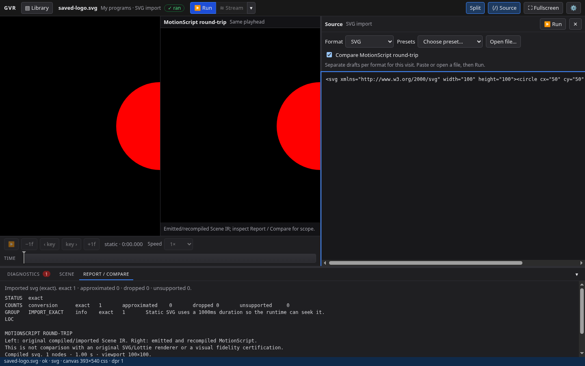
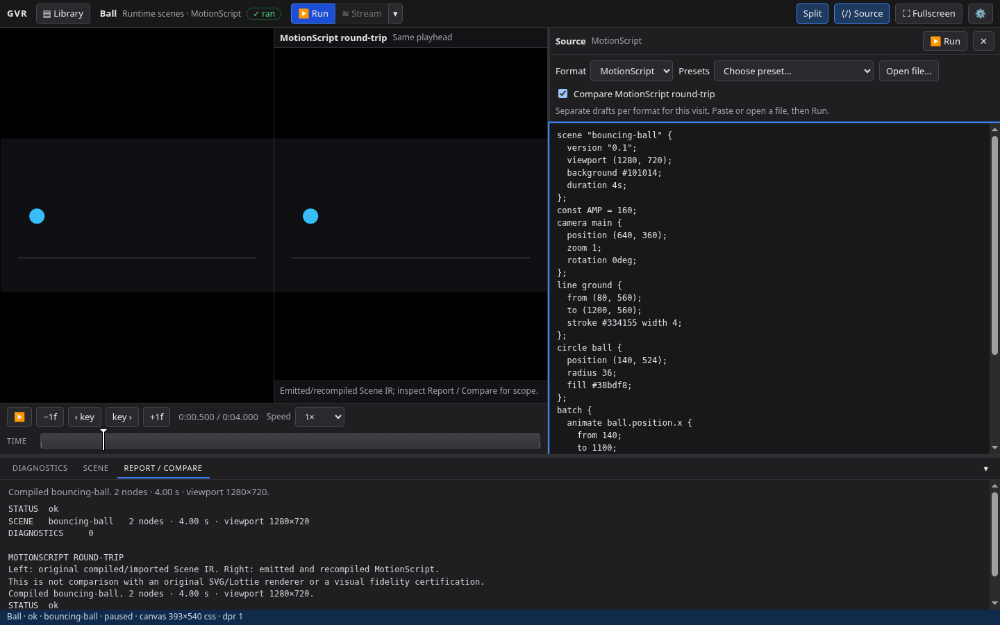
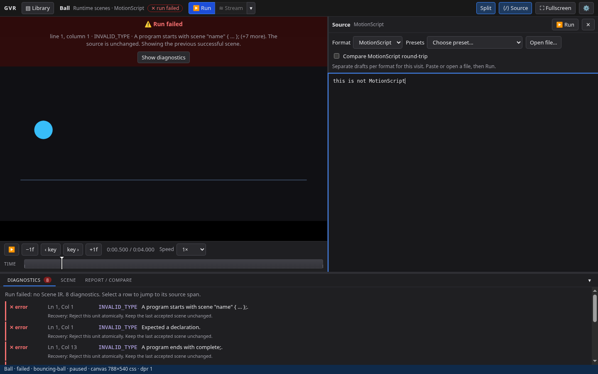

# P004 — Player Split and separate format drafts

Run: d7db7b86-c751-4c55-90a2-5be721423e30. Issue: #45. Date: 2 November 2026.
Verified implementation: `06c1a1b8ac50ebfe93a61f7105fcf48b8b13e0be`, including
current main's E023 / language 0.7.0 integration. Evidence-only additions follow
that revision; no implementation changes are omitted from the pin.

The user selected separate drafts per format. Split expands the single Player
Source editor with explicit format selection, existing presets and Open file.
MotionScript, Lottie, SVG and fixture drafts survive switching, close/reopen and
Library navigation for this visit. Presets/files wait for Run. Failed Run keeps
the source and previous successful scene with an explicit failure notice.

Compare defaults off. Enabling it emits/recompiles the successful Scene IR,
creates a second runtime at the shared playhead, and draws both canvases at the
same dimensions. Reports state the round-trip scope and distinguish it from
external-source visual certification. Disabling comparison removes the second
runtime/result; ordinary Run never calls the emitter. Existing importer coverage
and streaming contracts are unchanged. Legacy streaming remains until P002.

## Verification

- `npm run verify`: exit 0; 42 files / 297 tests, all repository typechecks,
  production Studio build, IR manifest validation, 33 operations tests and
  capability reference freshness.
- `npm run smoke:studio`: exit 0; 77/77 real Chromium checks. Node v24.19.0;
  Chromium 151.0.7922.173 on Linux. Checks include all four formats, draft
  preservation, explicit comparison/no default emission, identical sampled
  native comparison pixels, vertically aligned canvases, failed-run retention,
  file read errors and cancellation, narrow layout, existing Library/Player and
  legacy streaming regressions. [Machine-readable checks](browser-checks.json).
- `git diff --check`: clean. No deployment or package publication.

## Browser evidence

Implementation choice and failure review:
[Split draft decision](../../../decisions/product/2026-11-02-player-split-drafts.md).

## Intake and next gate

Accepted prospective request #88 into P008 #49; functionality indexes distinguish
released evidence from desired future outcomes. Current Studio delivery stays
first. No corpus was generated and director ownership remains a pre-corpus joint
decision. P002 is the next Studio delivery slice after P004, with its user-confirmed
rate/Advanced-control mockup still required. P006 remains dependent on open E006.
